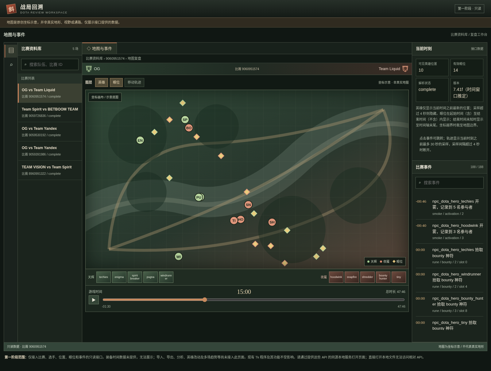

# Dota 2 复盘工作台：前端开发与接入测试总结

> **完成状态：第一阶段只读接入已实现并测试；完整前后端集成尚未完成。** 本次新增独立的本地 Web 工作台，没有替换原有 Tkinter 桌面程序。

## 一、界面设计过程

最初从 Dota 2 客户端的视觉语言出发，使用暗色石墨、低饱和绿、旧铜和暗红，形成游戏风格的复盘界面。随后按使用反馈压缩大标题和比赛横幅，将地图置于信息层级中心，并借鉴 VS Code、PyCharm 的工作台结构：左侧活动栏和比赛资料库，中间地图与时间轴，右侧比赛事件和当前时刻信息。

中央区域采用连续的“地图 → 双方英雄标识 → 时间轴”排列。当前接入版的英雄标识使用英雄名称文字，而非游戏官方头像。地图采用原创示意底图，使用实际坐标绘制英雄与眼位，但不代表真实地形、视野或通路。

## 二、真实数据接入后的界面截图

下图是在本次测试环境中，通过本机 HTTP 服务读取项目现有 SQLite 数据库后，由 Chromium 实际渲染并截取。画面为 OG 对 Team Liquid、比赛 ID 9060951574，在游戏时间 15:00 的状态。比赛、英雄位置、眼位和事件来自数据库；地图背景是示意图，截图不表示已经重建真实游戏画面。



## 三、本次实现

新增 `dota_review/web_server.py`，提供本机只读 HTTP 服务；新增 `dota_review/web_ui.html`，作为接入版前端；新增 `tests/test_web_server.py`，覆盖适配层与前端关键时间语义。原来的 `dota2_frontend_preview.html` 保留为设计概念稿，原 Tkinter 界面不受影响。

本阶段接通了目标战队比赛列表、比赛切换与搜索、英雄及选手信息、按游戏时间查询英雄位置、眼位与比赛事件。可以拖动或播放时间轴、点击事件跳转、切换英雄／眼位／轨迹图层，以及收起比赛资料库。比赛详情只传递页面所需字段，不传账号、数据库原始记录或本地文件路径。

后端只绑定 `127.0.0.1`，SQLite 以只读模式打开，并拒绝写操作；数据库读取不调用会建表或迁移的 `Store` 构造函数。此服务是本地工具，不应直接暴露到公网。

## 四、运行方法

在 Windows 的项目目录打开 PowerShell，使用项目配置好的 Python 环境运行：

```powershell
cd G:\AI0707\dota_agent
python -m dota_review.web_server
```

然后在本机浏览器打开 `http://127.0.0.1:8765/`。按 `Ctrl+C` 停止服务。如果端口被占用，可改用 `python -m dota_review.web_server --port 8766`，再访问对应端口。默认读取 `dota_data/review.sqlite3`；也可以通过 `--db 数据库路径` 指定数据库。

此命令的说明是基于项目路径与代码；本次自动化测试是在隔离 Linux 环境完成，**尚未在用户的 Windows 环境实际启动验证**。直接双击 `web_ui.html` 不会启动后端或读取数据库。

## 五、测试结果

在隔离 Linux 测试环境安装项目声明的 `gem-dota==0.13.0` 后，执行 `python -m unittest discover -s tests -v`：**16 项测试通过**，包括原有测试以及新增的只读接口、访问约束、数据字段、时间轴与眼位语义测试。

使用真实数据库及本机 HTTP 服务进行了 Chromium 浏览器联调。页面成功加载 **5 场比赛**；首场比赛返回 **10 名英雄和 188 条事件**。将时间轴调整到 05:00 时，画面显示 10 个英雄位置、9 个有效眼位。测试还验证了赛前负时间 `-00:30`、英雄图层开关、侧边栏收起与恢复、切换到另一场比赛，未观察到页面 JavaScript 错误。截图是在同一场比赛的 15:00 截取。

测试期间发现并修复了三个数据语义问题：赛前负时间此前无法访问；结束时间未知的眼位此前被错误隐藏；越界坐标此前被静默丢弃。当前负时间可显示并跳转；结束时间未知的眼位按项目既有规则显示至时间轴末尾并标明不确定性；越界坐标裁至边界并提示。比赛快速切换中请求被取消时，服务也已处理断连异常。

## 六、口径与尚未完成事项

当前 Web 页面仅为**只读核心复盘能力**，并非完整替代桌面应用。录像导入、报告导出、兵线／拉野候选、神符分析、BP 分析、英雄改动、多场趋势、角色与阈值编辑尚未在此页面接入；请继续使用原 Tkinter 程序处理这些功能。

装备历史快照尚未在项目数据库中保存，因此时间轴下方还没有真实装备面板。仅凭购买记录无法可靠重建每个时刻的完整物品槽位；需要先验证录像解析器可读字段、保存带时间的物品状态，再补做真实录像对照与缺失数据处理。

英雄位置按现有采样数据展示，最近样本超过 4 秒不再显示；眼位有效区间按 `[放置时间, 结束时间)` 处理。结束时间未知时，在时间轴内持续显示不代表能确认其正常存活。`7.41f` 标记为“时间窗口推定”，不是从录像精确确认的子版本。地图坐标示意不能用于判断精确地形、通路或视野。

真实比赛截图和测试不等于对所有录像、所有补丁或所有窗口尺寸完成验证。尚需在 Windows 目标环境验证启动与交互，并补充异常数据、性能、移动尺寸、装备采集和完整业务功能的端到端测试。
